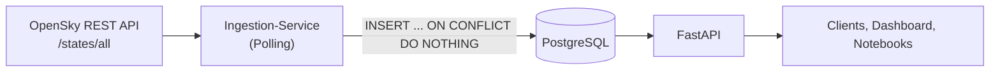

# Flightdata Platform

Eine kleine Daten-Plattform für ADS-B-Flugdaten: Sie holt regelmäßig Positionsmeldungen
vom [OpenSky Network](https://opensky-network.org/), speichert sie in PostgreSQL und stellt sie über eine
REST-API (FastAPI) bereit.

**Stand: Meilenstein 1** (Daten einlesen, speichern, per API abrufbar).
Die geplanten nächsten Schritte (Zustandsschätzung mit Kalman-Filter, Flugphasen-Erkennung,
Anomalieerkennung, ML) stehen in [docs/ROADMAP.md](docs/ROADMAP.md).

## Architektur



| Baustein | Aufgabe | Datei |
| --- | --- | --- |
| Parser | Rohdaten (JSON-Arrays) in validierte Datensätze umwandeln | `src/flightdata/opensky_parser.py` |
| Client | HTTP-Zugriff auf OpenSky inkl. OAuth2 und Rate-Limit-Behandlung | `src/flightdata/opensky_client.py` |
| Storage | Gesamte SQL-Logik (Speichern ohne Duplikate, Abfragen) | `src/flightdata/storage.py` |
| Ingestion | Polling-Schleife, übersteht einzelne Fehlschläge | `src/flightdata/ingest.py` |
| API | Endpunkte, Eingabevalidierung, Antwortmodelle | `src/flightdata/api/` |

## Schnellstart mit Docker

```bash
cp .env.example .env          # optional: OpenSky-Zugangsdaten eintragen
docker compose up --build
```

Danach:

- API-Dokumentation (Swagger UI): <http://localhost:8000/docs>
- Aktuelle Positionen im Raum Frankfurt:
  `curl "http://localhost:8000/states/latest?lamin=49&lomin=7&lamax=51&lomax=9"`

Der erste Abruf kann einen Moment dauern. `docker compose logs -f ingest` zeigt, wie viele Datensätze
pro Abruf ankommen.

## Lokale Entwicklung

Voraussetzungen: Python 3.11+, Docker (für die Datenbank).

```bash
python -m venv .venv
source .venv/bin/activate            # Windows: .venv\Scripts\activate
pip install -e ".[dev]"

docker compose up -d db              # nur die Datenbank starten
python -m flightdata.db              # Tabellen anlegen (einmalig)
python -m flightdata.ingest --once   # einmal Daten holen
uvicorn flightdata.api.main:app --reload
```

Tests und Linting:

```bash
pytest
ruff check .
```

Die Tests brauchen weder PostgreSQL noch Internet: Datenbanktests laufen gegen SQLite im Speicher,
der Parser wird mit selbst gebauten Beispielantworten getestet.

## API-Endpunkte

| Methode | Pfad | Beschreibung |
| --- | --- | --- |
| GET | `/health` | Lebenszeichen |
| GET | `/states/latest` | Neueste Position je Flugzeug. Optional `lamin`, `lomin`, `lamax`, `lomax` (Bounding Box, alle vier oder keiner), `max_age_minutes`, `limit` |
| GET | `/aircraft/{icao24}/track` | Verlauf eines Flugzeugs (chronologisch). Optional `since` (ISO 8601), `limit` |

## Konfiguration

Umgebungsvariablen mit Präfix `FLIGHTDATA_` oder eine `.env`-Datei (siehe `.env.example`).

| Variable | Standard | Bedeutung |
| --- | --- | --- |
| `FLIGHTDATA_DATABASE_URL` | lokale PostgreSQL | Datenbankverbindung |
| `FLIGHTDATA_OPENSKY_CLIENT_ID` / `_CLIENT_SECRET` | leer | OAuth2-Zugangsdaten. Ohne sie läuft der Client anonym |
| `FLIGHTDATA_INGEST_INTERVAL_SECONDS` | 120 | Pause zwischen zwei Abrufen |
| `FLIGHTDATA_BBOX_LAMIN`, `_LOMIN`, `_LAMAX`, `_LOMAX` | grob Deutschland | Abgefragter Bereich |

## Daten und Einheiten

OpenSky liefert pro Flugzeug einen *State Vector*. Einheiten:

- Höhen (`baro_altitude`, `geo_altitude`): Meter
- `velocity` (Geschwindigkeit über Grund) und `vertical_rate`: m/s
- `true_track`: Grad, im Uhrzeigersinn von Norden
- Zeitstempel: UTC

Datensätze ohne Position oder Positionszeit werden verworfen. Dieselbe Position kann bei mehreren
Abrufen wiederkommen, deshalb ist `(icao24, time_position)` eindeutig und Duplikate werden beim
Einfügen übersprungen.

## OpenSky: Nutzungsbedingungen und Limits

- Die OpenSky-API ist laut ihrer Beschreibung für nichtkommerzielle Forschung und Lehre gedacht.
  Lies die [Nutzungsbedingungen](https://opensky-network.org/about/terms-of-use), bevor du Daten
  weitergibst oder das Projekt öffentlich betreibst.
- Anonyme Abrufe haben deutlich kleinere Limits als Abrufe mit Account. Für den Dauerbetrieb solltest
  du dir einen Account anlegen und die Zugangsdaten in `.env` eintragen.
- Jeder Abruf kostet API-Credits, abhängig von der Größe der Bounding Box (laut Doku 1 Credit bis
  500×500 km, 2 Credits bis 1000×1000 km). Die Standardbox für Deutschland liegt in der zweiten
  Stufe. Bei 120 s Intervall sind das rund 1440 Credits pro Tag. Prüfe die aktuellen Limits in der
  [OpenSky-Doku](https://openskynetwork.github.io/opensky-api/rest.html), sie können sich ändern.

## Projektstruktur

```text
flightdata-platform/
├── src/flightdata/
│   ├── api/                 # FastAPI: main.py, routes.py, schemas.py
│   ├── config.py            # Einstellungen aus Umgebungsvariablen
│   ├── db.py                # Engine, Sessions, Tabellen anlegen
│   ├── geo.py               # BoundingBox
│   ├── ingest.py            # Polling-Service
│   ├── models.py            # SQLAlchemy-Modell
│   ├── opensky_client.py    # HTTP-Client
│   ├── opensky_parser.py    # Parser (reine Funktionen)
│   └── storage.py           # Speichern und Abfragen
├── tests/
├── docs/ROADMAP.md
├── .github/workflows/ci.yml
├── Dockerfile
├── docker-compose.yml
└── pyproject.toml
```

## Entwicklungsablauf

Ein Branch pro Aufgabe, kleine Commits, am Ende ein Pull Request (auch wenn du allein arbeitest).
Details und die ersten Aufgaben stehen in [docs/ROADMAP.md](docs/ROADMAP.md).
